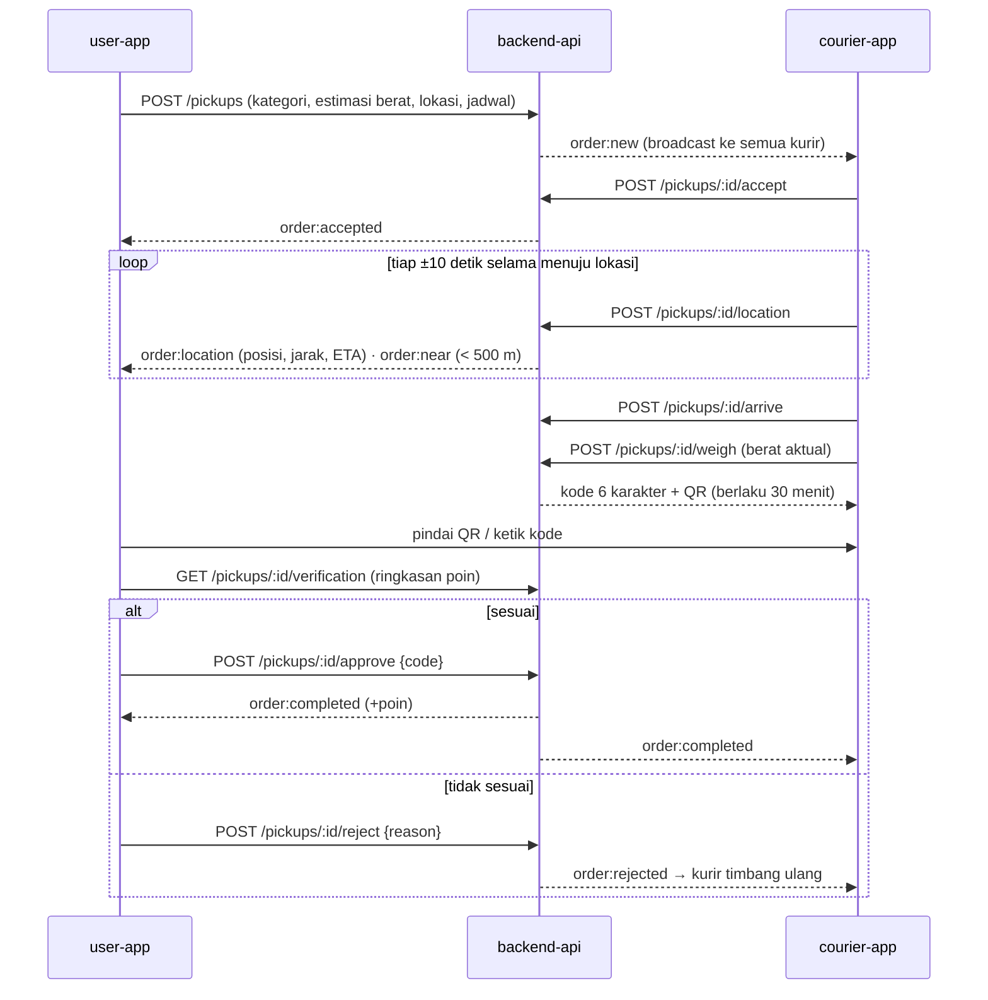

# 🌿 Eco-Donation

Eco-Donation adalah platform mobile yang menghubungkan penyetoran sampah daur ulang dengan donasi sosial. Pengguna meminta penjemputan sampah, kurir menimbang di lokasi, lalu pengguna **memindai QR di HP kurir** untuk menyetujui hasil timbangan. Poin yang diperoleh kemudian **didonasikan** ke kampanye sosial lokal atau organisasi nirlaba internasional melalui Every.org.

Proyek tugas besar mata kuliah Pemrograman Mobile Lanjut.

---

## 🧩 Komponen

| Folder | Isi | Teknologi |
|--------|-----|-----------|
| `backend-api` | REST API + Socket.io, database, aturan bisnis | Express 5, better-sqlite3, Zod, JWT, bcryptjs, Socket.io, Jest |
| `user-app` | Aplikasi warga: setor sampah, lacak kurir, pindai QR, donasi, lencana | Expo SDK 56, Expo Router, Zustand, expo-camera, expo-location |
| `courier-app` | Aplikasi kurir: ambil tugas, navigasi, timbang, tampilkan QR | Expo SDK 56, Expo Router, Zustand, expo-location, react-native-qrcode-svg |
| `scripts/sync-ui.js` | Menyalin design system `user-app/src/ui` ke `courier-app/src/ui` | Node.js |

Kedua aplikasi berjalan di **Expo Go** (tanpa build native). Peta memakai Leaflet di dalam WebView dengan tile CARTO/OpenStreetMap, dan pencarian alamat memakai Photon API. Semuanya gratis, tanpa API key.

```
┌──────────────┐   REST + WebSocket   ┌──────────────┐   REST + WebSocket   ┌──────────────┐
│   user-app   │ ◄──────────────────► │ backend-api  │ ◄──────────────────► │ courier-app  │
│  (Expo Go)   │                      │ Express+SQLite│                      │  (Expo Go)   │
└──────┬───────┘                      └──────────────┘                      └──────────────┘
       │ data kampanye internasional
       ▼
  Every.org API
```

---

## 🔄 Alur Penjemputan



| Status | Arti |
|--------|------|
| `waiting` | Menunggu kurir mengambil |
| `on_the_way` | Kurir menuju lokasi, lokasi dibagikan langsung |
| `arrived` | Kurir tiba dan menimbang |
| `pending_verification` | QR/kode aktif, menunggu persetujuan pengguna |
| `completed` | Disetujui, poin masuk ke saldo |
| `cancelled` | Dibatalkan pengguna |

---

## 🔐 Keamanan

- **Otorisasi berbasis peran**: token JWT berisi `{ sub, role }`. Pengguna hanya bisa melihat order miliknya, kurir hanya order yang ditugaskan kepadanya atau yang masih tersedia.
- **Kata sandi** di-hash dengan bcrypt. Input divalidasi dengan Zod, dan server memakai Helmet serta rate limit.
- **Kode verifikasi** dibuat acak secara kriptografis (tanpa karakter mirip seperti O/0 dan I/1), disimpan sebagai hash SHA-256, dibandingkan dengan perbandingan waktu-konstan, kedaluwarsa dalam 30 menit, dan terkunci setelah 5 kali salah. QR dibuat langsung di HP kurir; kode tidak pernah dikirim ke layanan pihak ketiga.
- **Socket.io** terautentikasi JWT. Setiap koneksi hanya masuk ke room `user:{id}` atau `courier:{id}` (ditambah `couriers` untuk broadcast order baru).
- **Poin dihitung di server** dari berat aktual. Klien tidak pernah mengirim jumlah poin.

---

## 💰 Poin & Dampak

| Kategori | Poin per kg |
|----------|-------------|
| Botol Plastik | 800 |
| Kertas | 600 |
| Kaleng | 1.000 |
| Botol Kaca | 500 |

- 1 poin = Rp1. Donasi minimal 1.000 poin.
- Setiap 1 kg sampah setara dengan ±1,5 kg emisi CO₂ yang dicegah.
- **Lencana** (Eco Warrior, Recycling Hero, Kind Heart, Top Donor) dihitung di server dengan tingkat perunggu, perak, dan emas.

---

## 🚀 Menjalankan

### Prasyarat
- Node.js 20 atau lebih baru dan npm
- Aplikasi **Expo Go** di HP (SDK 56)
- Laptop dan HP terhubung ke **WiFi yang sama**

### 1. Backend
```bash
cd backend-api
npm install
npm run seed     # buat database.sqlite berisi data demo
npm start        # http://0.0.0.0:3000  (atau: npm run dev untuk auto-reload)
npm test         # menjalankan seluruh test Jest
```
Konfigurasi opsional ada di `backend-api/.env.example`. Saat `NODE_ENV=production`, `JWT_SECRET` wajib diisi.

### 2. User App
```bash
cd user-app
npm install
npx expo start
```

### 3. Courier App
```bash
cd courier-app
npm install
npx expo start --port 8082
```

Pindai QR dari terminal Expo menggunakan Expo Go. Untuk menguji alur lengkap, jalankan kedua aplikasi di dua HP atau emulator yang berbeda.

### Alamat backend
Aplikasi otomatis memakai **IP laptop yang menjalankan `expo start`** dengan port 3000, sehingga biasanya tidak perlu mengubah apa pun. Jika memakai tunnel/ngrok atau jaringan berbeda, salin `.env.example` menjadi `.env` di folder aplikasi lalu isi:
```
EXPO_PUBLIC_API_URL=http://192.168.1.10:3000
```
Lalu jalankan ulang `npx expo start -c`.

### Akun demo (kata sandi `123456`)

| Peran | Email |
|-------|-------|
| Pengguna | `satrio@email.com`, `budi@email.com` |
| Kurir | `andi@kurir.com`, `bima@kurir.com` |

---

## 🎨 Design System

Komponen UI (`Button`, `Card`, `Input`, `Dialog`, `Toast`, `Segmented`, dan lainnya) berada di `user-app/src/ui`. Hanya `theme.ts` yang berbeda di tiap aplikasi: hijau `#0E7C66` untuk pengguna dan biru `#1D4ED8` untuk kurir. Setelah mengubah komponen di user-app:

```bash
node scripts/sync-ui.js          # salin ke courier-app
node scripts/sync-ui.js --check  # cek apakah sudah sinkron (exit 1 bila belum)
```

---

## 📁 Struktur Singkat

```
backend-api/
  index.js, seed.js
  src/
    routes/      auth, pickups, users, campaigns, notifications
    services/    logika bisnis (pickup, badge, notifikasi, user, kampanye)
    middleware/  auth JWT, validasi Zod, error handler
    socket.js    Socket.io + JWT
  tests/         Jest + supertest
user-app/src/    app/ (layar Expo Router), components/, ui/, services/, store/, lib/
courier-app/src/ app/ (layar Expo Router), components/, ui/, services/, store/, lib/, hooks/
docs/            spesifikasi desain
design & alur kerja sistem/   mockup dan catatan alur awal
```
